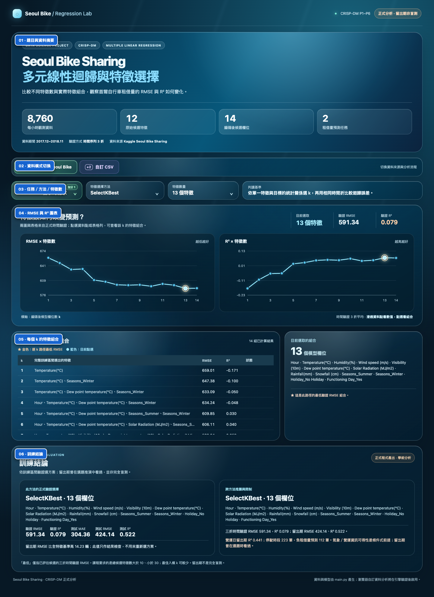
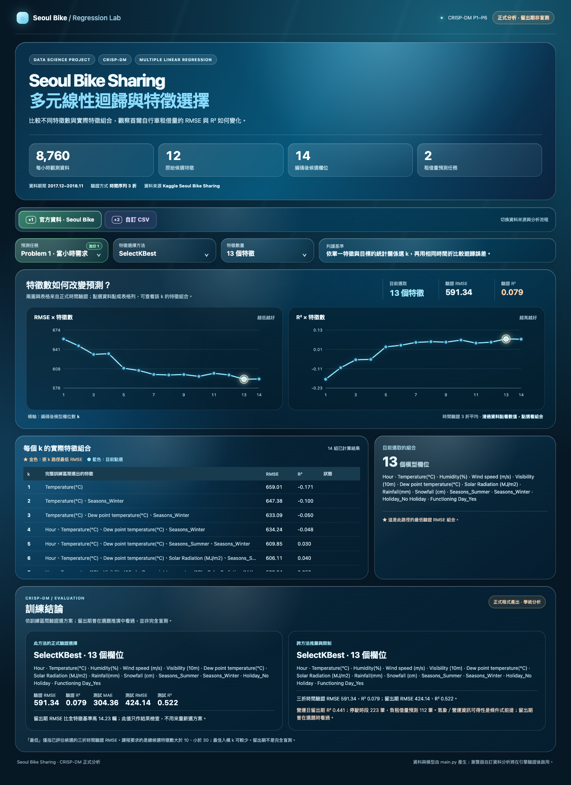
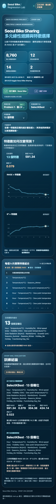
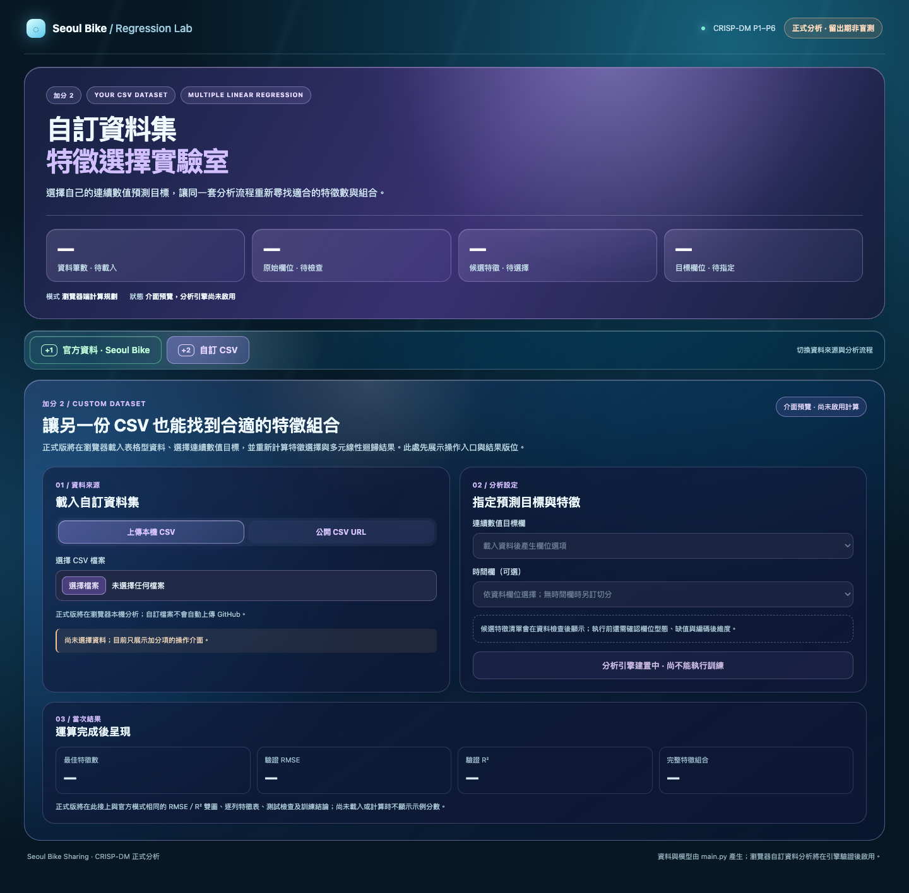
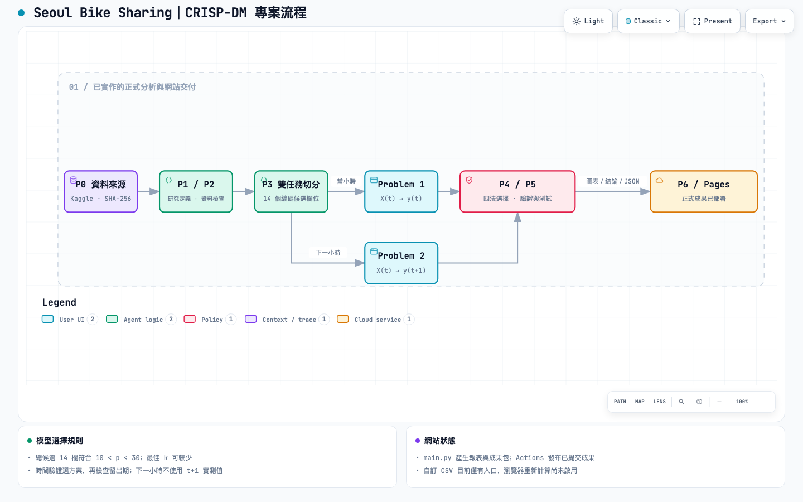

# Seoul Bike Sharing：多元線性迴歸與特徵選擇

AIIS HW2 專案。以 Kaggle Seoul Bike Sharing 的每小時資料，在 CRISP-DM P1～P6 流程中比較特徵選擇如何改變租借量預測。**目前網站已部署；自訂 CSV 的瀏覽器計算功能仍在開發。**

## Live Demo

[開啟互動網站](https://iloveu-tw.github.io/AIIS_HW2_Seoul_Bike_Sharing/) · [部署紀錄](https://github.com/iloveu-tw/AIIS_HW2_Seoul_Bike_Sharing/actions/workflows/pages.yml)

本機預覽：

```bash
python3 -m http.server 8765
# 開啟 http://127.0.0.1:8765/site/index.html
```

網站現可切換兩個預測任務、四種方法及實際存在的特徵數，查看驗證 RMSE／R² 雙圖、逐列特徵組合與訓練結論。自訂 CSV 的介面已顯示，但瀏覽器計算引擎仍在開發，頁面會明確標示未啟用。

## 預測問題與資料

| 任務 | 目標 | 輸入時點 |
|---|---|---|
| Problem 1 | 當小時租借量 | 已取得當小時氣象與營運狀態 |
| Problem 2 | 下一小時租借量 | 使用 `t` 時點已知欄位預測 `t+1`；不使用 `t+1` 實測欄位 |

來源為 [Kaggle Seoul Bike Sharing Version 1](https://www.kaggle.com/datasets/joebeachcapital/seoul-bike-sharing/versions/1)。原始資料 8,760 筆、14 欄；12 個原始候選輸入展開為 14 個模型欄位。作業條件 `10 < 特徵數 < 30` 用於**總候選特徵數**，最佳入模數 `k` 可以較少。原始 CSV 不上傳至公開儲存庫；取得後放在 `data/raw/SeoulBikeData.csv`，`main.py` 會核對 SHA-256。

## 重現正式分析

使用 Python 3.13，安裝 `requirements.txt` 後執行：

```bash
python3 main.py
```

`main.py` 是唯一正式分析程式，標示 CRISP-DM P1～P6，產生 `results/current_hour/`、`results/next_hour/` 的研究定義、資料檢查、切分、特徵選擇、圖表及訓練結論，並輸出 `site/data/results.json` 供互動頁使用。既有 `src/00_*.py` 是 P0 來源驗證紀錄，不是另一套正式模型。

目前比較全特徵、SelectKBest、Lasso CV 與 RFECV。Lasso CV 用 `GridSearchCV(Pipeline(StandardScaler, Lasso))` 實作，讓尺度轉換只在各內層訓練折擬合；Lasso path／RFE path 圖是逐 `k` 探索，與正式交叉驗證選擇分開標示。

## 目前結果與限制

目前正式程式的時間驗證推薦：當小時為 SelectKBest 的 13 欄；下一小時為 RFECV 的 6 欄。這是**本資料、此切分與已評估候選**下的結果，不代表普遍最優。留出期曾在選題推演中查看，並非完全盲測；完整數字和營運日分層結果見 [當小時結論](results/current_hour/P5/conclusion.md)與[下一小時結論](results/next_hour/P5/conclusion.md)。

## 完整網站截圖

下列圖片直接擷取自 2026-10-20 已部署網站版本 `971401e`。原圖全部保留在 [`docs/screenshots/`](docs/screenshots/)，檔名、用途與雜湊見[截圖索引](docs/screenshots/INDEX.md)，可供繳交作業時下載與貼用。

### 功能區塊標註版（桌面）



### 桌面原圖與手機版





### 自訂資料入口現況



此截圖顯示加分 2 的入口與版位；計算功能尚未啟用，因此不將它列為已完成的加分結果。

## Archify 專案流程圖

[開啟可互動流程圖](https://iloveu-tw.github.io/AIIS_HW2_Seoul_Bike_Sharing/architecture/crisp_dm_workflow.html) · [查看可重建 JSON 來源](docs/architecture/crisp_dm_workflow.json) · [查看驗證紀錄](docs/architecture/crisp_dm_workflow.visual-check.json)



圖中的 P1／P2 與 P4／P5 為了在單一畫面清楚閱讀而合併顯示；`main.py` 仍逐階段執行。圖表、報告及網站成果已交付；自訂 CSV 重新計算尚未啟用。Archify showcase 驗證為 9／9、0 錯誤、0 警告；瀏覽器檢查涵蓋四種桌面尺寸與明暗主題。圖中文字採繁體中文，Archify 檢視器的固定控制項顯示英文。

## 規格與交接

- [完整規格](docs/spec.md)
- [開發前檢核與更正紀錄](docs/reports/2026-10-20-pre-development-check.md)
- [選題試跑報告](docs/reports/2026-10-20-seoul-feasibility-dry-run.md)

舊版 `docs/PROJECT_PLAN.md`、`docs/PROJECT_RULES.md` 與 P0 文件保留供追溯；實作以 `docs/spec.md` 的最新定義為準。
